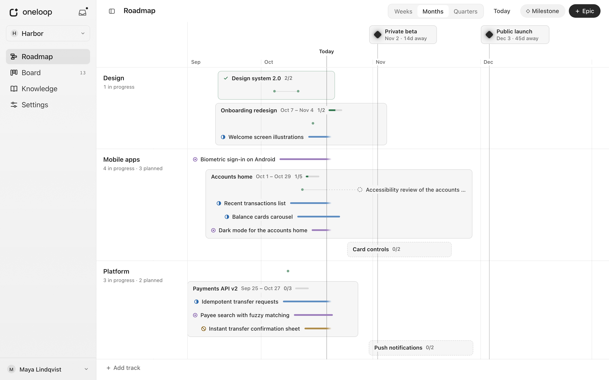
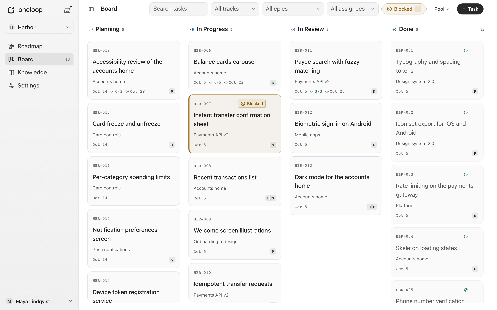
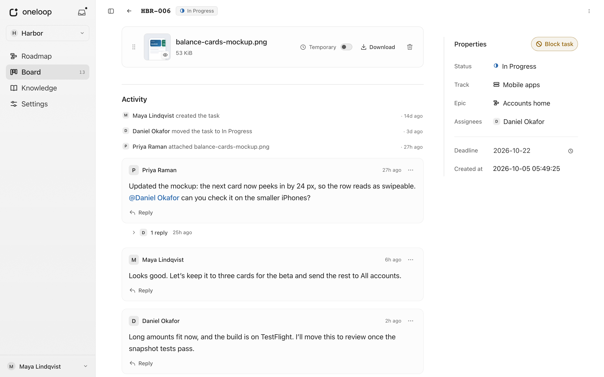

# User guide

## How work is organized

| Item | What it is | Example |
| --- | --- | --- |
| Project | All the work that one team plans together. Switch projects at the top of the sidebar. | Customer portal |
| Track | A long-running stream of work in a project. | Backend and API |
| Epic | A piece of work on one track, with a start date and an optional end date. | Payment integration |
| Milestone | A goal with a date, across all tracks. | Public launch |
| Task | One thing to do, on a track. It can be part of an epic on the same track. | Add card payments |

Every task is on a track. An epic is optional: put a task in one when it is
part of that piece of work. A task without an epic stays on its track.

Give an epic an end date when its work has one. Work that never ends, such as
small fixes, needs no epic: keep those tasks on their track.

The address of the **Board**, the **Roadmap**, **Knowledge** and **Settings**
names the project, so a refresh, a bookmark or a link opens the same project.
An address without a project, such as an older bookmark, opens the project you
last switched to in this browser, or else your first project. A link to a
project you can't open shows **Page not found**. When you sign out, the
address drops the project, the Board's filters and the Roadmap's scale, so the
next person who signs in there starts from their own project.

What you can change depends on your access to the project. Without the
**Roadmap** or **Board** permission, that page is **read only**, but you can
still comment. See [Permissions](admin-guide.md#permissions).

## Roadmap

The Roadmap shows what each track has finished, is working on and has
planned with a date, on a timeline with one lane for each track. It is the
first page you see after you sign in.

- **Done work** shows as dots on the day it was finished. Where dots would be
  too close to tell apart, the work of a few days becomes a number: one a
  day at **Weeks**, every four days at **Months** and every twelve days at
  **Quarters**, so steady work reads as a row of numbers across time. Click a
  number to list its tasks. A list shows up to 50 tasks and says how many
  more the **Board** has. Where a plan falls on a day with done work, the two
  sit side by side.
- **Work in progress**, in progress or in review, shows as one row per task: a
  thin bar from when work started to its deadline, or to today, fading out,
  without one. Each lane, and each epic, shows three at most: late work
  first, then blocked work, then the nearest deadline. **+2 in progress**
  lists the rest, 50 at most, and says how many more the **Board** has.
  Blocked work is amber. Late work has a red error icon and a red end past
  its deadline.
- **Plans with a deadline** show as dashed rings on their deadline, with their
  title where it fits. Rings too close to tell apart become a number, as done
  work does. While a ring's task loads, a short grey bar holds the place of
  its title. If it can't load, the ring says **Couldn't load**, and a press
  still lists the task. It tries again by itself, after 5 seconds, then 15,
  then every minute, and at once when the connection comes back. Plans
  without a deadline stay on the **Board**.
- A track's name says how many of its tasks are in progress and how many are
  planned, with a deadline or not. A lane without any of this says **No dated
  work**, or **No tasks yet** when its track has no tasks.
- An **epic** is a box around its work, with its dates when it has an end
  date, and how many of its tasks are done. An epic without an end date runs
  from its first work to today. An epic with nothing on the timeline yet
  shows just its name after today, or at its start when that is later.
- **Milestones** are cards above the lanes, with a line down through them.
  Milestones too close for a card each share one, such as **2 milestones**,
  which lists them when you hover over it or focus it.
  **Today** is the thin line under its label. When tasks are late, **Overdue**
  and their number show next to the page's title; each click shows the next
  late task, the longest overdue first, through the 20 longest overdue. One on
  days the Roadmap hasn't loaded yet comes into view first.
- Hover over a task, an epic or a milestone, or move the keyboard focus to it,
  to see its details. Click it, or press Enter, to open the task, the epic's
  progress, tasks and activity, or the milestone. A dot, a ring and a row of
  a list open their task the same way. Deadlines are set on the task's page.
- The Roadmap opens at the scale that shows the last three weeks of done work,
  the work in progress and the next six weeks of dates. **Weeks**, **Months**
  and **Quarters** set the scale, and so do the keys W, M and Q. A new scale
  keeps the task or epic you last focused, or today, in view. To zoom freely,
  hold Ctrl (Cmd on macOS) while you scroll, or pinch on a touchpad or touch
  screen. On a narrow screen, the scale buttons make room for the others;
  pinch or use the keys instead. **Today** takes you back to today.
- A scale you choose is part of the page's address, so a refresh keeps it
  and you can share the Roadmap at that scale as a link. After a free zoom,
  the address keeps the nearest scale. Changing the scale adds no step to the
  browser's history. Another project opens at the scale that fits its work.
- The days around what you see load first, and more days load as you
  scroll to them. Every day shows all of its done work and plans, at any
  scale, however busy the project. Changes made elsewhere show as they
  happen.
- With the keyboard, Tab reaches each track's grip, its **⋮** menu and its
  timeline. In a timeline, the arrow keys, Home and End move between the
  lane's epics and tasks, Up and Down move to the next lane, and Esc closes a
  list. Back from a task you opened there puts focus back where you opened
  it, or on its lane's timeline when the task is no longer there.
- On a phone, each track's name sits above its lane, and the Roadmap opens at
  **Weeks**.
- Add work with **+ Epic**, **Milestone** and **+ Add track** under the lanes.
  To reorder tracks, drag the grip next to a track's name, or focus the grip
  and use the arrow keys, Home and End. A track's **⋮** menu renames or
  deletes it.
- You can delete a track only when it has no tasks and no epics; **Delete
  track** says how many to move or delete first. Moving an epic to another
  track moves its tasks with it. Deleting an epic keeps its tasks on its
  track, without an epic, and **Undo** right after brings it back with them.
  With the **Board** permission, **New task** in an epic's details opens the
  task form with the epic and its track filled in.

### Epic status

| Status | Meaning |
| --- | --- |
| Planning | Not started yet. Every new epic starts here. |
| In progress | Work has started. oneloop sets this when one of the epic's tasks first moves to In Progress or In Review. |
| Done | Someone closed the epic with **Mark as done**. |

oneloop never closes an epic by itself, even when all its tasks are done. A Done
epic can't get new tasks, but its existing tasks can still change. **Reopen**
moves an epic back to In progress if some of its tasks are in progress or in
review, and to Planning otherwise.

An epic with an end date shows how many of its tasks are done. An epic
without one shows the tasks closed this week, closed since it started, and
still open. Weeks start on Monday.

## Board

The Board shows the project's tasks in four columns:

| Status | Meaning |
| --- | --- |
| Planning | Defined, but not started. New tasks start here. |
| In Progress | Someone is working on it. |
| In Review | Ready for someone to check. |
| Done | Complete. |

A task can move to any status at any time, for example back to In Progress after
a review.

- **+ Task** creates a task. It needs a title and a **Track**. Track starts
  filled in when oneloop can tell where the task goes: the project's only
  track, the track the Board is filtered to, or the track of the last task
  you created in this project in this tab. **Epic** is optional and offers the
  open epics of that track, or of every track until you choose one. Choosing
  an epic also chooses its track. A project without tracks needs one first.
- A card shows its epic under its title, or its track when it has no epic.
- Drag a card to change its status or its place in the column. On a touch
  screen, drag it by its **⋮** button. The **⋮** menu can also move it, which
  works well with a keyboard.
- A new task, also one made from a Pool idea, starts at the top of
  **Planning**. A task that changes status without a place, such as with
  **Move to** or its **Status**, goes to the top of its new column. A card you
  drag, or move with **Move up** and **Move down**, goes exactly there.
- Use the filters to find tasks by text, track, epic (**No epic** for tasks
  without one) or assignee, or to show
  only blocked tasks. Several choices in one filter show more tasks; several
  filters together show fewer. The filters are part of the page's address, so
  a refresh keeps them and you can share a filtered Board as a link. Changing
  them adds no step to the browser's history, so **Back** leaves the Board. A
  choice the project no longer has, such as a deleted track, is dropped.
- **Done** shows the most recently finished tasks first by itself, because a
  task that moves there goes to its top. To put a finished task elsewhere,
  drag it or use **Move up** and **Move down**.

### Pool

The **Pool** holds ideas that aren't tasks yet. An idea has a title and an
optional description. Your **My** Pool is private, even from admins. The
**Team** Pool is shared with the project. When an idea is ready, click it to
turn it into a task, with a track and an optional epic, as with **+ Task**.

## Tasks

Click a card to open the task. Your changes save automatically. To save the
field you are typing in at once, press Ctrl+S (Cmd+S on macOS); you stay where
you are. In a dialog, such as **New task**, or while you edit a comment, Ctrl+S
does what the dialog's main button does. It never sends a new comment or reply,
and it doesn't save the page as a file, except from inside an HTML file preview.

- The **Description** shows formatted Markdown (GitHub style), such as
  headings, lists, tables and code, and keeps the line breaks you type. Click
  the text, or choose **Edit**, to change it. Leave the field, or press Esc or
  Ctrl+Enter (Cmd+Enter on macOS), to save it and see it formatted again.
  Task keys of your projects, such as `WEB-042`, link to their tasks. Boxes in
  a task list show what the text says; to tick one, edit the text.
- Links to other sites open in a new tab. Links to oneloop pages, such as a
  task, open in the same tab, in descriptions and in Markdown files alike.
- **Track** and **Epic** show where the task is. An epic stays on one track,
  so moving a task to another track takes it out of its epic, and a note under
  **Epic** says why. **Epic** offers the open epics of the task's track;
  **No epic** takes the task out of its epic and keeps it on its track.
- **Assignees** can be any project members. They get an Inbox notification when
  you assign them.
- **Deadline** is a date. When that day ends in your team's timezone, a task
  that isn't Done shows **Overdue**.
- **Activity** shows comments and changes in one timeline.
- If someone else changes a task field or comment while you are editing it,
  oneloop keeps your text and shows theirs next to it. Choose **Use latest** or
  **Keep my changes**.
- A title or description you change while offline stays on the page, marked
  **Not saved**, and saves when the connection returns.
- oneloop asks before you go to another page, also with the browser's **Back**
  and **Forward** buttons, while text you typed, such as a comment, isn't sent
  or saved yet. Most browsers also ask before you reload or close the tab. A
  dialog with text you typed asks before **Escape** closes it.
- To delete a task, use the **⋮** menu at the top of the page.

### Checklist

A task's **Checklist**, below its description, splits the work into items.

- **Add an item** stays ready after Enter, so you can type the next item at
  once, within the [checklist limits](reference.md#limits).
- An item's text saves when you press Enter or leave it. To move an item, drag
  its handle, or focus the handle and use the arrow keys, Home and End.
- **×** removes an item at once, without Undo.
- The heading and the Board card count the done items, such as **2/5**. The
  card's count turns green once every item is done. Items don't move the task,
  so a task can be Done with items open.
- People who can't change the Board see the items, but not an empty checklist.

### Blocking

When something stops the work, choose **Block task** and write the reason.
Mention people in the reason with `@` to notify them. The card then shows a
**Blocked** badge.

- The task keeps its status while it is blocked. **Unblock task** removes the
  block and notifies the assignees.
- Done tasks can't be blocked. If you move a blocked task to Done, oneloop
  offers to unblock and complete it in one step.

### Files

Drop files on a task, or click **browse files**. Any file type is fine, within
the [file limits](reference.md#limits). Everyone in the project can open the
files. Comments can't have files.

Click a file to preview it. oneloop shows images, PDFs, Markdown (with tables,
math and Mermaid diagrams), HTML pages, text and code. You can download any
file. Diagrams show math in their labels as plain text, such as `$$x^2$$`.

HTML previews show the page without running its scripts or loading anything
from other sites, such as images, styles and fonts. Styles, images and fonts
inside the file still show. To use the page fully, download it. The browser
keeps the page and usually opens it again without downloading it, unless the
file changed; **Reload preview** gets it from the server again.

Mark a file **Temporary** if oneloop may remove it when storage runs low. A
removed file then shows **Cleaned up**. oneloop never removes other files by
itself.

### Undo a deletion

After you delete a task, an epic, a file or a comment, the message that
confirms it has an **Undo** button while it is shown. Ctrl+Z (Cmd+Z on macOS) does the same
while focus is not in a text field and no dialog is open. The message stays
while the pointer or focus is on it. Undo puts the item back where it was,
with its comments and files. A task goes back to the same place in its column,
also when a new task took its place meanwhile; another item goes at the end of
its list then. People who left the project meanwhile are no longer assigned to
a restored task, unless it is done. A restored epic takes back the tasks that
are still on its track without an epic, and a restored task whose epic was
deleted comes back without it. A task whose track was deleted meanwhile can't
come back. The history keeps the deletion, the undo and these changes.

If Undo fails because the connection dropped or the server was busy, the
message that says so offers **Undo** again until the item can no longer be
restored.

Deleted files and comment text stay on the server for the
[Undo window](reference.md#limits), so that Undo can work. Soon after that,
oneloop removes them for good, together with the files of a deleted task. A
deleted task's own text and its comments stay in the database; only its files
are removed.

## Knowledge

**Knowledge** in the sidebar opens the project's **Knowledge base**: your
team's guides, product rules and decisions, from one folder of a Git repository
that an admin connects. It is read-only and stands on its own, without links to
tasks or epics. To change a file, change it in Git; oneloop shows the change
after its next [sync](reference.md#limits).

- A folder's **README.md** appears below its list of files. **Updated** is
  estimated from the Git history oneloop fetched. If that history does not
  include a file's last change, the date can be newer than the change.
- Files that oneloop previews [on tasks](#files) open inside the page; other
  files can only be downloaded. **Full view** opens the same viewer as task
  files.
- Relative links in Markdown open the linked file or folder here, and relative
  images appear in the text.
- To copy a link to part of a document, hover over a heading and choose
  **#**.

Search with the field at the top, or press `/`. It looks at file and folder
names, and at the text of Markdown and text files, within the
[search rules and limits](reference.md#limits). Use the arrow keys and Enter to
open a result, and Esc to close the search.

When a sync fails, the page shows **Knowledge may be out of date** and keeps the
files from the last successful sync. Admins can choose **Retry sync**.

## Comments and mentions

Write a comment under the task's activity and press Enter to send it.
Shift+Enter starts a new line. Every project member can comment, even with a
read-only Board.

- **Reply** answers a comment in its thread.
- You can edit and delete your own comments. Admins can edit and delete any
  comment. You can [undo a deletion](#undo-a-deletion).
- To mention someone, type `@` and pick the person from the list. Only people
  you pick get a notification. A name you type yourself, or a mention inside
  `code` or a quote, is plain text.
- **@everyone** notifies all active members of the project except you. It has a
  [rate limit](reference.md#limits) in each project.
- When you edit a comment or block reason, only people you newly mention get a
  notification. Editing keeps mentions of people who have left the project.

## Inbox

The Inbox shows what needs your attention in all your projects. Open it with the
icon next to the oneloop logo. A dot means you have unread items. Nobody else
can see your Inbox, not even an admin.

You get a notification when:

- someone mentions you, or uses @everyone, in a comment or a block reason;
- someone replies to your comment;
- someone assigns a task to you;
- a task assigned to you is unblocked.

You never get notifications for your own actions. Status changes and new
files don't notify anyone.

Click an item to open the task at the right place; this also marks the item
read. **Archive** puts an item away. You can filter by project or show only
unread items. **Mark all as read** and **Archive all** affect every item matching
the current filters, including later pages. While a project or **Unread** filter
is on, they read **Mark filtered as read** and **Archive filtered**. There is no
bulk undo, but you can restore individual items from **Archived** and use
**Mark unread**. See
[retention limits](reference.md#limits) for how long archived items remain.

## Your account

Click your name at the bottom of the sidebar. The menu has **Profile**,
**Sign out**, and the theme: **Light**, **Dark** or **System**. **System**, the
default, follows your device's light or dark setting, and the theme you choose
applies to this browser only.

When oneloop is upgraded, open tabs show **oneloop was updated** and reload by
themselves at a safe moment: nothing you typed would be lost, nothing is open,
such as a dialog, a menu, a file preview or an **Undo** offer, and the tab is
hidden or you haven't used it for five minutes. A temporary password that is
still on screen counts as something that would be lost. **Reload now** reloads
at once. A reloaded page shows the same address, so you keep your project and
Board filters.

On your **Profile**:

- Change your avatar (PNG, JPEG or WebP) and your full name. See the
  [file limits](reference.md#limits). Your username can't change.
- Change your password. This signs out your other sessions and your connected
  apps.
- **Sessions** lists every browser where you are signed in. You can sign out
  any of them; your connected apps stay connected.
- **Connected apps** lists your AI assistants, and you can revoke them. See
  [AI assistants](mcp.md).

Sessions end by themselves after a while; see
[session length](reference.md#limits).

If your session ends while you type, sign in again in the same tab and your
text comes back. The tab keeps it only in memory, and drops it when you sign
out there or someone else signs in there. Tabs of one browser share a session:
when you sign out, your other open tabs sign out too, but keep what you typed
in them, except in a dialog. It comes back when you sign in again there and
open its page. When someone else signs in, your open tabs show that your
session ended instead of their work.

If you forget your password, ask an admin to reset it. You get a temporary
password and choose a new one when you sign in.
